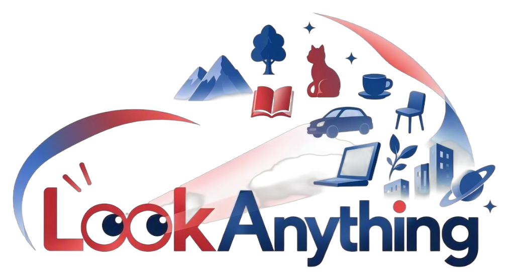
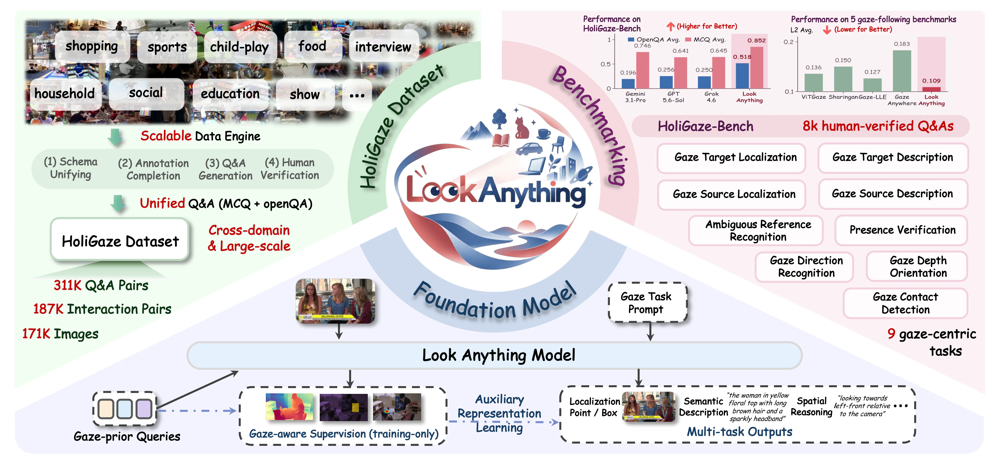
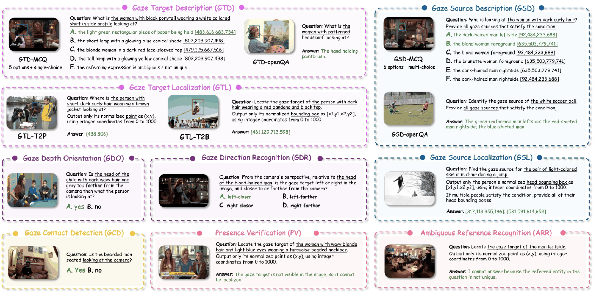

<div align="center">



<h1>LookAnything</h1>

<h3>A Foundation Model for Holistic Gaze Following</h3>

<p><strong>Jiayu Tang</strong><sup>1,2,*</sup> · <strong>Yuchen Zhou</strong><sup>2,*,†</sup> · Hongsheng Wu<sup>3</sup> · Hanjing Ye<sup>2</sup> · Ke Huang<sup>4</sup><br>
Cheng Wang<sup>1</sup> · Yuqin Dai<sup>5</sup> · Yufei Huang<sup>2</sup> · Yonggen Ling<sup>2</sup> · <strong>Chao Gou</strong><sup>1,†</sup></p>

<p><sup>1</sup>Sun Yat-Sen University · <sup>2</sup>Tencent Robotics X · <sup>3</sup>Futian Laboratory<br>
<sup>4</sup>Hong Kong Polytechnic University · <sup>5</sup>Tsinghua University<br>
<sup>*</sup>Equal contribution · <sup>†</sup>Corresponding authors</p>

<p>
  <a href="https://look-anything.github.io/"></a>
  <a href="https://arxiv.org/abs/2611.32351"></a>
  <a href="https://look-anything.github.io/#demo"></a>
  <a href="https://github.com/Look-Anything/LookAnything"></a>
  
</p>

</div>

## 🔍 Overview

**LookAnything** brings gaze target localization, description, and reasoning into one instruction-following vision-language model. Its learnable **gaze-prior queries** capture scene depth, source-head information, and target geometry through auxiliary supervision, removing the need for external head crops or depth maps at inference. The model supports **points, boxes, heatmaps, and natural-language answers** across diverse scenes and tasks.

The accompanying **HoliGaze** dataset contains **311K question-answer pairs**: a **303K-sample training corpus** and **HoliGaze-Bench**, an **8K-sample human-verified evaluation set**. Together they span **nine gaze-centric tasks** in **five capability dimensions**.

<div align="center">
  <a href="assets/overview.webp"></a>
  <br>
  <sub>LookAnything unifies gaze-centric tasks with the HoliGaze data engine and benchmark. Click to view the full-size figure.</sub>
</div>

## ✨ Highlights

- **One model, many gaze tasks.** LookAnything handles gaze target and source understanding, spatial reasoning, social interaction, and query answerability in a unified framework.
- **Gaze-aware representations.** Learnable queries are trained with depth, head, and target geometry supervision; auxiliary decoders can be skipped during inference.
- **Broad evaluation.** The paper compares LookAnything with 33 vision-language models on HoliGaze-Bench, evaluates it on five conventional gaze-following benchmarks, and demonstrates real-world deployment on a Unitree G1 robot.

## 🧭 HoliGaze at a glance

<div align="center">
  <a href="assets/holigaze-figure2.webp"></a>
  <br>
  <sub>Figure 2 from the paper: HoliGaze task taxonomy and Q&amp;A examples. Click to view the full-size figure.</sub>
</div>

| Capability | Tasks |
| :-- | :-- |
| Gaze target understanding | Target localization and description |
| Gaze source understanding | Source localization and description |
| Gaze spatial reasoning | Depth orientation and direction recognition |
| Gaze social interaction | Gaze contact detection |
| Gaze query answerability | Ambiguous reference recognition and presence verification |

HoliGaze-Bench combines open-ended questions and multiple-choice questions. Its 8K evaluation pairs cover 6,143 images and are verified at the instance level.

## 🛠️ To-Do List

We are actively preparing the public release. Resources will be added here as they become available.

- [ ] Release **cleaned code** for inference, training, and evaluation, with setup instructions.
- [ ] Release **LookAnything model weights** and a minimal inference example.
- [ ] Release **HoliGaze-Bench** on Hugging Face, with annotations, evaluation protocol, and scoring scripts.

We will update this README with download links and reproducibility instructions as each resource becomes available.

## 📚 Citation

If LookAnything or HoliGaze is useful for your research, please cite:

```bibtex
@article{tang2026lookanything,
  title   = {LookAnything: A Foundation Model for Holistic Gaze Following},
  author  = {Tang, Jiayu and Zhou, Yuchen and Wu, Hongsheng and Ye, Hanjing and Huang, Ke and Wang, Cheng and Dai, Yuqin and Huang, Yufei and Ling, Yonggen and Gou, Chao},
  journal = {arXiv preprint arXiv:2611.32351},
  year    = {2026},
  url     = {https://arxiv.org/abs/2611.32351}
}
```
